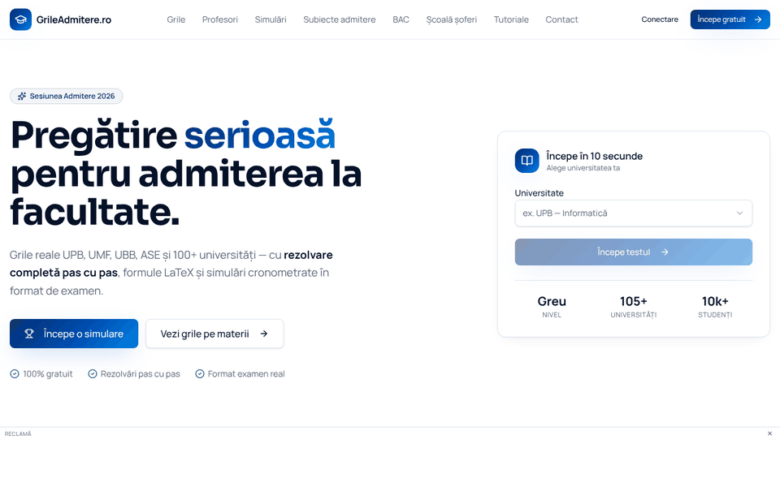
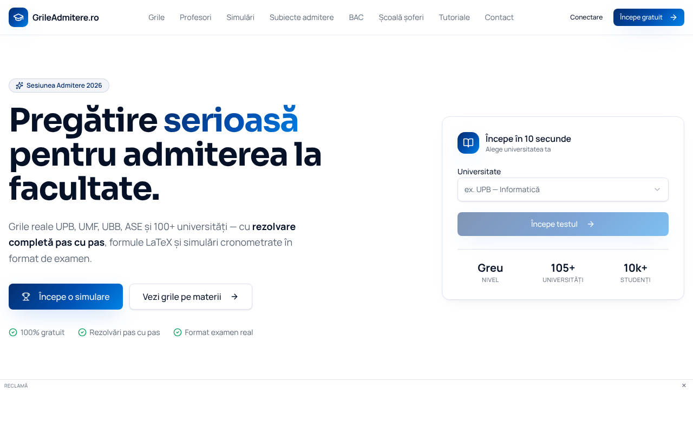

# GrileAdmitere.ro

Free practice platform for the Romanian university admission exams and the Baccalaureate:
solved multiple-choice questions (grile), timed exam simulations, past BAC papers and a daily
blog that explains one grilă step by step.

**Live:** https://grileadmitere.ro



## Features

- **Question bank** for 100+ universities and faculties (UPB, UBB, UMF, ASE, UAIC, UTCN, Drept, Poliție),
  every question with the correct answer and a step-by-step solution (Markdown, LaTeX and C++ code).
- **Interactive quizzes** (`/quiz/:subject`) and **timed simulations** in the real exam format (`/simulare`).
- **Grila zilei** – one new question every day.
- **BAC papers** by year and subject, admission papers per university.
- **Daily content job** – new questions, simulations and a detailed grilă solution article are added every day.
- **SEO first** – server-side rendered pages, per-page metadata, Open Graph image, `Quiz`/`Question`,
  `Article` and `BreadcrumbList` structured data and a dynamic `sitemap.xml`.



## Tech stack

| Layer      | Technology                                                    |
| ---------- | ------------------------------------------------------------- |
| Framework  | React 19, TanStack Start (SSR), TanStack Router, React Query    |
| UI         | Tailwind CSS 4, Radix UI, KaTeX, react-markdown               |
| Data       | PostgreSQL (Supabase), Drizzle migrations, `pg_cron`          |
| Runtime    | Cloudflare Workers (Nitro build)                              |
| Tests      | Vitest                                                        |

## Getting started

Requirements: Node.js 22+ and [Bun](https://bun.sh) (the lockfile is `bun.lock`).

```sh
git clone https://github.com/alexalghisi/grile-clone-builder.git
cd grile-clone-builder
bun install
bun run dev
```

The app runs at http://localhost:8080.

### Environment

The public Supabase settings are already in `.env`. Server-side features need:

| Variable                    | Used for                                        |
| --------------------------- | ----------------------------------------------- |
| `SUPABASE_SERVICE_ROLE_KEY` | server functions, sitemap, daily content job    |
| `LOVABLE_API_KEY`           | daily content generation                        |
| `FIRECRAWL_API_KEY`         | importing admission papers                      |

## Scripts

| Command             | Description                      |
| ------------------- | -------------------------------- |
| `bun run dev`       | development server               |
| `bun run build`     | production build                 |
| `bun run preview`   | serve the production build       |
| `bun run lint`      | ESLint + Prettier                |
| `bunx vitest run`   | unit tests                       |
| `bunx tsc --noEmit` | type check                       |

## Project structure

```
src/
  routes/          file-based routes (pages, API hooks, sitemap.xml)
  components/      shared UI
  lib/             server functions and domain logic (daily content, quizzes, BAC papers)
  integrations/    Supabase clients and generated types
drizzle/migrations SQL migrations
public/            static assets, robots.txt, og-image.png
```

## Daily content job

`pg_cron` calls `POST /api/public/hooks/daily-content?steps=3` every 10 minutes. Each call runs a few
checkpointed steps until the day is complete:

1. three articles, each a detailed solution of a question that has no article yet;
2. 250 new questions across five subjects, saved together with one practice simulation per subject.

Progress, the lease that prevents overlapping runs and the pause reason live in `content_job_state`.
